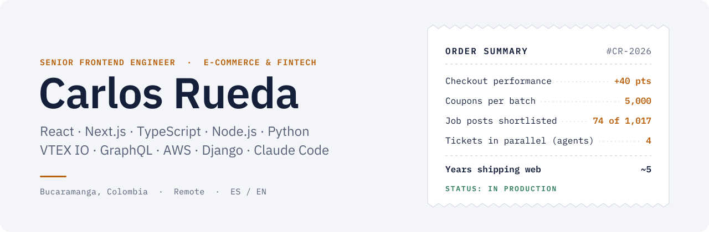
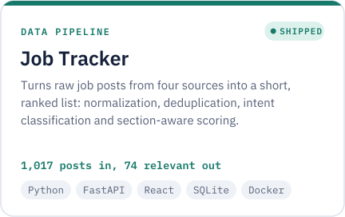
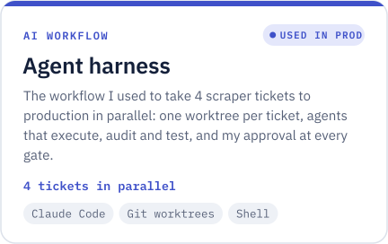
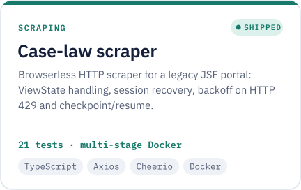
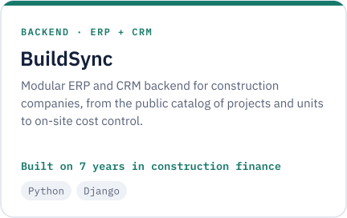
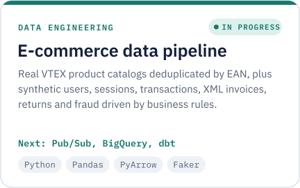
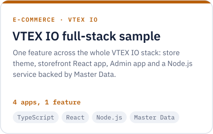
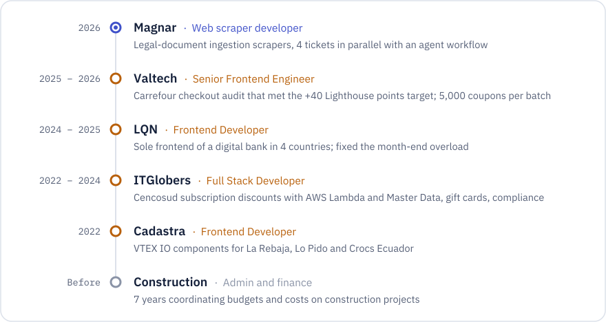
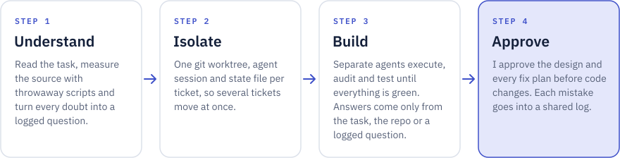
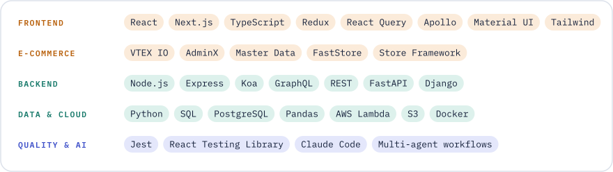

<picture><source media="(prefers-color-scheme: dark)" srcset="banner-dark.svg"></picture>

I build e-commerce and fintech products with <b>React, Next.js, TypeScript and Node.js</b>, with Python and Django on the backend. Nearly 5 years in production, more than 3 of them on <b>VTEX IO</b>. In my latest role I shipped with AI agents: I design the workflow and own the decisions, and the agents do the repetitive work.

Open to <b>remote</b> roles as Full Stack or Senior Frontend Engineer in e-commerce, fintech and teams that already work with agents.

  <a href="https://www.linkedin.com/in/carlos-rueda-calier"><picture><source media="(prefers-color-scheme: dark)" srcset="btn-linkedin-dark.svg"></picture></a>
  <a href="mailto:arturorueda88@gmail.com"><picture><source media="(prefers-color-scheme: dark)" srcset="btn-email-dark.svg"></picture></a>
  <a href="https://github.com/CarlosDev88/?tab=repositories"><picture><source media="(prefers-color-scheme: dark)" srcset="btn-github-dark.svg"></picture></a>

 

<picture><source media="(prefers-color-scheme: dark)" srcset="h-work-dark.svg"></picture>

  <a href="https://github.com/CarlosDev88/Job-Tracker"><picture><source media="(prefers-color-scheme: dark)" srcset="card-jobtracker-dark.svg"></picture></a>
  <a href="https://github.com/CarlosDev88/agent-harness"><picture><source media="(prefers-color-scheme: dark)" srcset="card-harness-dark.svg"></picture></a>

  <a href="https://github.com/CarlosDev88/jurisprudence-jsf-viewstate-scraper"><picture><source media="(prefers-color-scheme: dark)" srcset="card-scraper-dark.svg"></picture></a>
  <a href="https://github.com/CarlosDev88/buildsync"><picture><source media="(prefers-color-scheme: dark)" srcset="card-buildsync-dark.svg"></picture></a>

  <a href="https://github.com/CarlosDev88/ecommerce-data-pipeline"><picture><source media="(prefers-color-scheme: dark)" srcset="card-pipeline-dark.svg"></picture></a>
  <a href="https://github.com/CarlosDev88/vtex-react-app-fortune-cookie"><picture><source media="(prefers-color-scheme: dark)" srcset="card-vtex-dark.svg"></picture></a>

Also: <a href="https://github.com/CarlosDev88/real-estate-credit-backoffice">real-estate-credit-backoffice</a> (Django REST Framework MVP for Colombian real-estate credit applications) and <a href="https://github.com/CarlosDev88/deteccion-neumonia-cnn">deteccion-neumonia-cnn</a> (CNN trained from scratch in TensorFlow/Keras, coursework).

  

<picture><source media="(prefers-color-scheme: dark)" srcset="h-exp-dark.svg"></picture>

<picture><source media="(prefers-color-scheme: dark)" srcset="timeline-dark.svg"></picture>

  

<picture><source media="(prefers-color-scheme: dark)" srcset="h-agents-dark.svg"></picture>

<picture><source media="(prefers-color-scheme: dark)" srcset="workflow-dark.svg"></picture>

  

<picture><source media="(prefers-color-scheme: dark)" srcset="h-stack-dark.svg"></picture>

<picture><source media="(prefers-color-scheme: dark)" srcset="stack-dark.svg"></picture>

  

<picture><source media="(prefers-color-scheme: dark)" srcset="h-now-dark.svg"></picture>

- Finishing a Specialization in Big Data and Data Analytics at Universidad de Cataluña (December 2026).
- Taking the e-commerce data pipeline to Pub/Sub, BigQuery, dbt and a public dashboard.

 

<b>Versión en español</b>

 

**Full Stack Engineer** que construye productos de e-commerce y fintech con React, Next.js, TypeScript y Node.js, con Python y Django en el backend. Casi 5 años en producción, más de 3 sobre VTEX IO. En mi último trabajo entregué con agentes de IA: yo diseño el flujo y tomo las decisiones, y los agentes hacen el trabajo repetitivo.

Busco trabajo **remoto** como Full Stack o Senior Frontend Engineer, sobre todo en e-commerce, fintech y equipos que ya trabajan con agentes.

**Proyectos destacados**

- **[Job Tracker](https://github.com/CarlosDev88/Job-Tracker):** convierte publicaciones de empleo de cuatro fuentes en una lista corta y ordenada. En una corrida real pasó de 1.017 publicaciones a 74 relevantes.
- **[Arnés de agentes](https://github.com/CarlosDev88/agent-harness):** el flujo con el que llevé 4 tickets de scrapers a producción en paralelo, con un worktree por ticket, agentes que ejecutan, auditan y prueban, y mi aprobación en cada paso.
- **[Scraper de jurisprudencia](https://github.com/CarlosDev88/jurisprudence-jsf-viewstate-scraper):** scraper HTTP sin navegador para un portal legacy, con recuperación de sesión, backoff y checkpoint/resume. 21 tests.
- **[BuildSync](https://github.com/CarlosDev88/buildsync):** backend modular de ERP y CRM para constructoras, que sale de mis 7 años en finanzas de obra.
- **[Pipeline de datos de e-commerce](https://github.com/CarlosDev88/ecommerce-data-pipeline)** (en construcción): catálogos reales de tiendas VTEX y datos sintéticos guiados por reglas de negocio.
- **[Ejemplo full stack en VTEX IO](https://github.com/CarlosDev88/vtex-react-app-fortune-cookie):** tema de tienda, app React, app de Admin y servicio Node.js con Master Data.

**Experiencia:** Magnar (2026, scrapers de ingesta de datos con agentes), Valtech (2025–2026, Senior Frontend Engineer: checkout de Carrefour con la meta de +40 puntos en Lighthouse cumplida y cupones masivos en AdminX), LQN (2024–2025, único frontend de una banca digital en 4 países), ITGlobers (2022–2024, Full Stack en clientes de Cencosud) y Cadastra (2022, componentes VTEX IO). Antes, 7 años como coordinador administrativo y financiero de obra.

**Ahora:** terminando la Especialización en Big Data y Analítica de Datos (Universidad de Cataluña, diciembre de 2026) y llevando el pipeline de e-commerce a BigQuery y dbt.

[LinkedIn](https://www.linkedin.com/in/carlos-rueda-calier) · [arturorueda88@gmail.com](mailto:arturorueda88@gmail.com)

